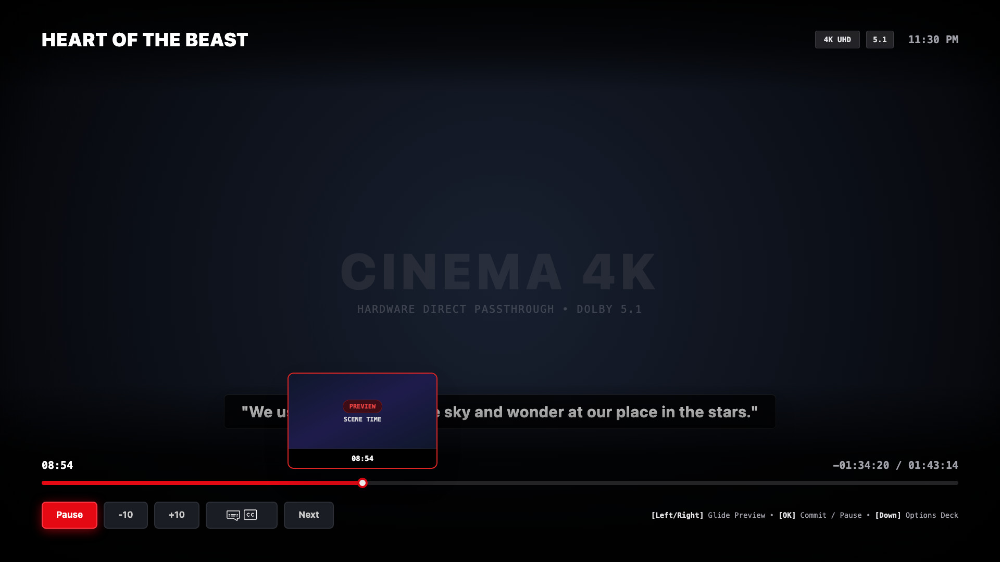
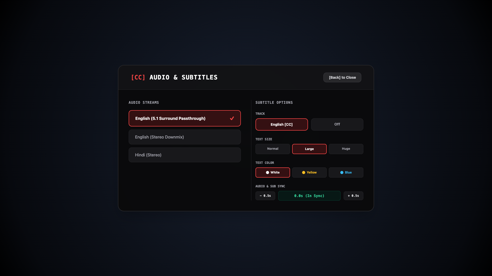
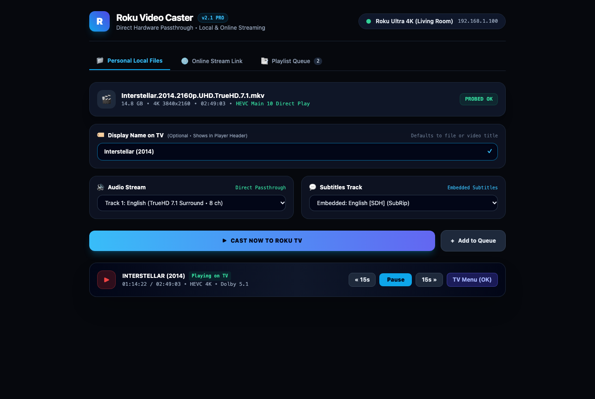

# 📺 Roku Video Caster (V2.2 PRO)

[](https://github.com/TenacityMind/RokuVideoCaster/releases)
[](LICENSE)
[](https://golang.org)
[]()
[](https://developer.roku.com)

A dedicated, high-performance streaming & video casting system built **exclusively for Roku TV**. 

Cast personal local movies and online videos directly to your Roku TV with zero buffering, multi-track audio switching (Dolby Atmos / 5.1 passthrough), continuous playlist queues, and an interactive on-screen media player with real-time subtitle font sizing and sync adjustment.

---

## 📸 Screenshots & UI Showcase

### 📺 Netflix-Style Roku TV Player & Scene Slider Preview

*Cinematic on-screen player with signature Netflix Red scrub bar, custom video title, 4K/5.1 resolution badges, 16:9 trick-play scene slider preview card, and uniform 5-button action bar.*

### 🎛️ Centered Audio & Subtitles Configuration Modal

*Dual-column TV modal for seamless on-the-fly audio stream switching (English 5.1 / Stereo), subtitle font sizing (`Normal / Large / Huge`), text color, and ±0.5s audio/sub synchronization.*

### 💻 Modern Mac & PC Web Control Dashboard

*Dark glassmorphic Web UI with local drag-and-drop, optional **Display Name on TV** field, automatic stream analyzer, subtitle management, and live playback dock.*

---

## ✨ Features

- **📺 Roku TV Exclusive:** Zero DLNA or Chromecast overhead. Built specifically for Roku OS using the native SceneGraph framework.
- **⚡ Hardware Direct Passthrough:** Direct hardware streaming for 4K UHD, HDR, and Dolby Atmos/5.1 surround sound without local transcoding.
- **🛡️ Built-in Transparent HLS Proxy:**
  - Circumvents CDN anti-hotlink protection (`403 Forbidden` / Referer checking) on online streaming hosts (e.g. `flixer.gd`, `flixer.su`).
  - Seamlessly tunnels browser-captured `Referer` and `User-Agent` headers upstream for every segment.
  - Rewrites both master and sub-playlist manifests in real time, converting relative URLs and CMAF fMP4 (`.m4s` + `#EXT-X-MAP`) chunks into fully playable local streams for Roku TV.
- **📁 Intelligent Local File Streaming:**
  - Drop or pick any video file (`.mp4`, `.mkv`, `.m4v`, `.mov`) in the Web UI.
  - **Smart Disk Discovery:** Automatically locates files in your user folders (`~/Downloads`, `~/Movies`, `~/Desktop`, `~/Videos`) even when standard browser sandboxes omit absolute file paths.
  - **Full Byte-Range Seeking:** HTTP `206 Partial Content` streaming enables immediate scrubbing and instant seek on Roku's native hardware decoder.
  - Inspects resolution, duration, audio tracks, and embedded subtitles via `ffprobe`.
- **🌐 Headless Chrome Stream Scraper:**
  - Paste streaming links or video pages (e.g. `primeshows.org`, `flixer.su`, `flixer.gd`).
  - Automated headless Chrome engine navigates iframes, bypasses Cloudflare Turnstile, and intercepts direct `.m3u8` master and variant playlists.
  - Robust false-positive filtering prevents web manifest stalls and suppresses raw CMAF segment clutter.
- **🎮 Netflix-Style Cinematic TV Player UI & Remote Controls:**
  - **🎞️ Scene Slider Preview (Trick Play Thumbnails):** Pressing or holding `Left` or `Right` glides a floating 16:9 thumbnail preview card along the red timeline showing the scene and timestamp. Playback is not interrupted until you press `OK` to commit the seek!
  - **Instant 140ms Hardware Extraction & In-Memory Caching:** Dynamic thumbnail generation powered by `ffmpeg` on your host machine, serving cached frames in `10ms` for both local files and online streams (Flixer, HLS, MP4).
  - **Uniform Netflix Action Deck:** Clean, symbol-free action buttons: `[Play / Pause]`, `[-10]`, `[+10]`, `[Audio & Subtitles Icon]`, and `[Next]`.
  - **Netflix Remote Control Key Behavior:**
    - `OK` while playing: Pauses video and displays options deck.
    - `Down` while playing: Shows controls deck without pausing video (plays in background).
    - `Up`: Direct one-click jump into Subtitles & Audio modal.
    - `Back`: Stepwise dismiss (Slider Preview -> Options Deck -> TV Home Screen).
    - `5-Second Auto-Hide`: OSD automatically fades out after 5s of inactivity when playing.
  - **Netflix Centered Dual-Column Subtitles & Audio Modal:**
    - Left Column: Audio stream switcher (`English 5.1`, `Stereo`, etc.) with active checkmark.
    - Right Column: Subtitle tracks, sizing (`Normal / Large / Huge`), colors (`White / Yellow / Sky Blue`), and `±0.5s` sync nudging.
  - **Pure ASCII UI:** 100% ASCII indicators eliminate missing rectangular glyph boxes across all Roku OS system fonts.
- **🏷️ Optional Custom Display Title on TV:**
  - Enter any custom movie, show, or episode title in both Local Video and Online Stream tabs.
  - Automatically pre-populates with clean filenames or scraped stream titles.
  - Renders prominently in bold uppercase on the TV top header alongside resolution and surround tags.
- **🏠 Cinematic TV Home Screen / Dashboard:**
  - Displays a clean emerald green `* READY TO CAST` status on startup.
  - Features a high-contrast glowing pill displaying your computer's actual local network IP (e.g. `http://192.168.1.100:8080`) so you can open the dashboard instantly on your phone, tablet, or laptop.
- **💬 Flexible Subtitle Fallback:** If an online video lacks subtitles, pair it instantly with your own uploaded `.srt`/`.vtt` file or direct subtitle link.
- **📑 Continuous Playlist Queue:** Queue multiple episodes or movies with auto-advance to the next video when finished.
- **🚀 Standalone Single Binary:** macOS and Windows single-file executables with embedded web dashboard. No Node.js, Go, or Python needed to run!
- **📱 Android Companion App:** System share target ("Share to Roku TV") from Chrome, YouTube, Brave, or Firefox.

---

## 🛠️ Roku TV Quick Setup (One-Time)

To allow sideloading the native channel onto your Roku TV:

1. **Enable Developer Mode on Roku TV:**
   - On your physical Roku remote, press in sequence:
     ```
     Home 3x  ➜  Up 2x  ➜  Right  ➜  Left  ➜  Right  ➜  Left  ➜  Right
     ```
   - Select **Enable installer and restart**.
   - Note down the **Roku TV IP Address** displayed on screen (e.g., `192.168.1.50`).
   - Set a developer password (e.g., `your-password`).
2. **Done!** You only ever need to do this once.

---

## 🚀 Running the App

### macOS
Download `roku-caster` and double-click, or run in Terminal:
```bash
./bin/roku-caster
```
*The web dashboard opens automatically at `http://localhost:8080`.*

### Windows
Download `roku-caster-win.exe` and double-click to launch.

### Sideloading the Channel to TV (One-Click)
1. Open the dashboard at `http://localhost:8080`.
2. Click the TV connection badge in the top-right corner.
3. Enter your **Roku TV IP** and **Developer Password**.
4. Click **"Sideload / Update Channel on TV"**. The channel will install and appear on your Roku TV home screen!

### CLI Sideload / Update Option
You can also sideload or update the channel directly from the command line:
```bash
./bin/roku-caster -install -ip 192.168.1.50 -password your-password
```

---

## 🎮 Netflix Remote Navigation Shortcuts

| Mode | Remote Key | Action |
| :--- | :--- | :--- |
| **Video Playing** | **`Left` / `Right`** | **Glide Scene Slider Preview** (16:9 thumbnail preview card glides along timeline without pausing video) |
| | **`OK`** | **Pause video** & reveal Options Deck |
| | **`Down`** | **Show Options Deck without pausing** (video continues playing in background) |
| | **`Up`** | **Instant 1-Click Jump** into Centered Subtitles & Audio modal |
| | **`Back`** | Dismiss player & return to TV Home Screen |
| **Scene Slider Preview** | **`Left` / `Right`** | Glide forward/backward smoothly to inspect scenes and target times |
| | **`OK`** | **Commit Seek** to target timestamp and resume video |
| | **`Back`** | Cancel preview & return to regular playback |
| **Options Deck (Bottom)** | **`Left` / `Right`** | Navigate uniform buttons (`[Play/Pause]`, `[<< 10s]`, `[10s >>]`, `[[CC] Subtitles & Audio]`, `[Next Video >>|]`) |
| | **`OK`** | Activate selected button |
| | **`Up` / `Back`** | Dismiss deck HUD back to clean video |
| **Audio & Subtitles Modal** | **`Up` / `Down`** | Navigate between Audio Streams, Subtitle Tracks, Sizing, Colors, and Sync |
| | **`Left` / `Right`** | Select option or adjust sync offset (±0.5s) |
| | **`OK` on Sync** | Reset sync timing to `0.0s (In Sync)` |
| | **`Back`** | Close modal and resume playback |

---

## 🏗️ Building from Source

Requirements: Go 1.22+ and `zip`.

```bash
# Clone the repository
git clone https://github.com/TenacityMind/RokuVideoCaster.git
cd RokuVideoCaster

# Build macOS binary
make build-mac

# Build Windows .exe
make build-win

# Build all binaries
make build-all
```

---

## 📱 Android Companion App

The `android/` directory contains an Android Studio project with an `ACTION_SEND` intent filter.
When you tap **Share** in mobile Chrome or Brave on any video link, choose **"Roku Video Caster"** to instantly send the video to your Roku TV!

---

## 🙏 Acknowledgements & Credits

Special thanks to the [Castor](https://github.com/stupside/castor) project by [stupside](https://github.com/stupside) for:
- The automated headless Chrome scraping architecture and stealth browser techniques.
- Turnstile challenge evasion and automated video player evaluation methods.
- Foundational direct media streaming and subtitle synchronization concepts.

---

## 📄 License
MIT License. Built for seamless, ad-free streaming on Roku TV.
